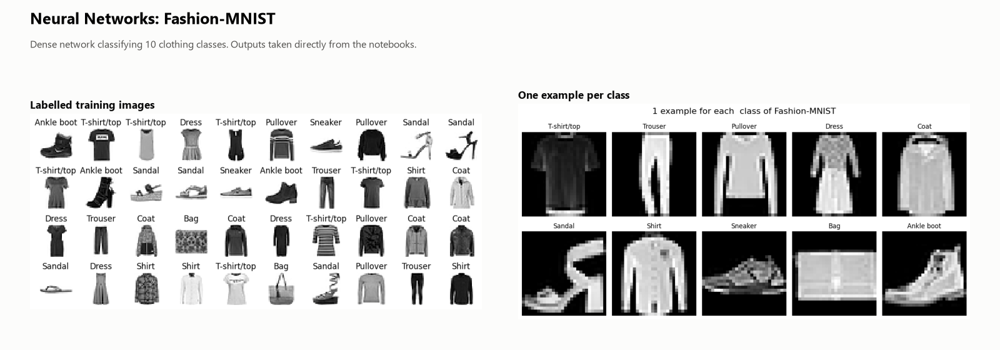

# Neural Networks

Dense neural networks in TensorFlow and Keras on Fashion-MNIST (10 clothing classes): data preparation, network architecture with batch normalization and dropout, training and evaluation.

## Notebooks

- [`Fashionmnist_Neural_network.ipynb`](Fashionmnist_Neural_network.ipynb)
- [`Neural_Network.ipynb`](Neural_Network.ipynb)
